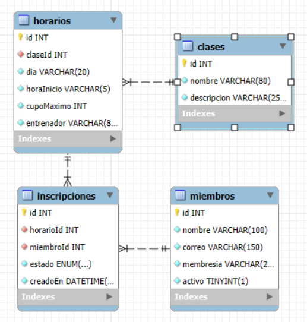

## Preguntas Práctica 9

**¿Qué línea del Service o del Controller tuvo que cambiar para que Clases hablara con MySQL?**

Ninguna, solo cambié el useClass en clases.module.ts para que usara ClasePrismaRepository.

**¿Por qué InscripcionesService no tuvo que cambiar ni una línea de las reglas de cupo y duplicados?**

Porque el service solo usa los métodos del repositorio y no le importa de dónde salen los datos. El repositorio de Prisma tiene los mismos métodos que el de memoria, así que sigue igual.

**Una de las cuatro opciones es indispensable: sin ella la validación no hace nada y tampoco avisa**

transform: true

**¿Por qué una interfaz no puede validar nada en tiempo de ejecución?**

Porque las interfaces desaparecen al compilar, entonces cuando corre el programa ya no existen y no hay dónde guardar las reglas de validación.

**¿Qué código de estado responde y qué trae en el cuerpo?**

Responde 400 Bad Request. En el cuerpo viene message, error y statusCode.

**¿Cuántas líneas quedó más corto el controlador?**

81 - 55 = 26 líneas más corto.

**Si la respuesta llega en los dos casos, ¿quién bloquea realmente y a quién protege?**

Bloquea el navegador, no el servidor. El servidor responde siempre, pero si el origen no está permitido, el navegador no deja que la página lea la respuesta. Protege al usuario, no a la API.


# Gimnasio API — Código base (Semana 5)

API REST en NestJS para el gimnasio: `Clases`, `Horarios`, `Miembros` e `Inscripciones`, cada
módulo con dominio, DTOs e infraestructura separados (patrón repositorio + inyección por token).
Los datos viven en memoria — ningún repositorio se conecta todavía a una base de datos real.

Este proyecto es el punto de partida de la Práctica 8 (Prisma) y la Práctica 9 (Blindar la API).

## Cómo correrlo

```bash
npm install
npm run start:dev
```

El servidor levanta en `http://localhost:3000`. En `peticiones.http` está la batería completa de
pruebas (requiere la extensión "REST Client" de VS Code).

## Estructura

```
src/
  clases/        CRUD de clases del gimnasio
  horarios/      CRUD de horarios (día, hora, cupo, entrenador)
  miembros/      CRUD de miembros del gimnasio
  inscripciones/ inscribir a un miembro a un horario, con reglas de cupo y duplicados
  datos/         datos de arranque (seed) que usan Horarios y Miembros
```

Cada módulo sigue la misma forma: `dominio/` (entidades + interfaz del repositorio), `dto/`,
`infra/` (repositorio en memoria) y el token de inyección en `<módulo>.tokens.ts`.

## Diagrama de la base de datos


